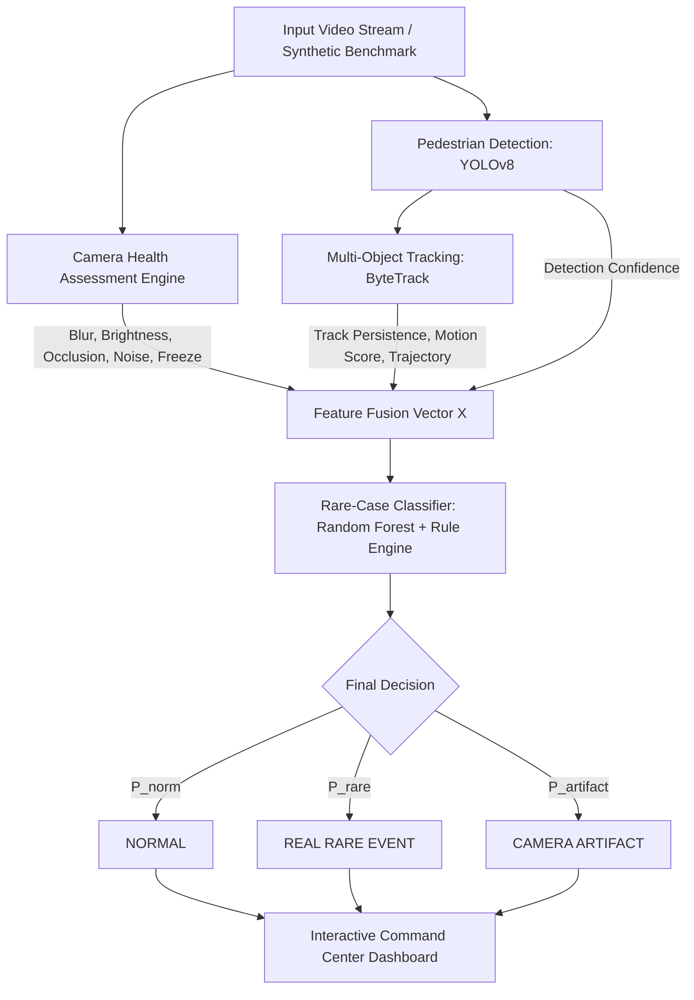

# Rare Pedestrian Detection with Camera Health Awareness 👁️‍🗨️

> **Phát hiện người đi bộ trong các tình huống hiếm có xét đến tình trạng sức khỏe của camera**

Dự án nghiên cứu và phát triển hệ thống thị giác máy tính thông minh tích hợp **Camera Health Assessment** (đánh giá chất lượng cảm biến theo thời gian thực) với mô hình **YOLOv8** và thuật toán tracking **ByteTrack**, nhằm phân biệt chính xác giữa:
1. **NORMAL** — Người đi bộ trong điều kiện camera chuẩn.
2. **REAL RARE EVENT** — Người đi bộ hiếm nhưng có thật (ban đêm, mưa lớn, ánh sáng yếu, che khuất một phần, motion rõ rệt).
3. **CAMERA ARTIFACT / SENSOR FAULT** — Báo động giả do lỗi camera (vệt nước, bùn đất đọng trên lens, camera bị out-focus/blur, camera bị freeze/hang).

---

## 🏗️ Kiến trúc Hệ thống (System Architecture)



---

## 👥 Phân chia trách nhiệm cho 4 Thành viên

| Thành viên | Vai trò | Module phụ trách | Deliverables |
|---|---|---|---|
| **Member 1** | **Pedestrian Detection Engineer** | `src/detection/` | - `detector.py`: YOLOv8 wrapper, tuning confidence & IoU thresholds<br>- Fine-tuning weights: `yolov8n.pt` / `weights/pedestrian_detector.pt` |
| **Member 2** | **Camera Health Engineer** | `src/camera_health/` | - `blur.py`: Laplacian Variance<br>- `brightness.py`: Luminance & Contrast analysis<br>- `occlusion.py`: Temporal Static Invariance & Smudge detection<br>- `freeze.py`: Inter-frame delta monitoring<br>- `health_score.py`: Weighted Camera Health Vector $H$ |
| **Member 3** | **Tracking & ML Engineer** | `src/tracking/`, `src/rare_case/` | - `tracker.py`: ByteTrack two-stage association<br>- `trajectory.py`: Persistence, displacement & motion scoring<br>- `features.py`: Feature fusion vector extraction<br>- `classifier.py` & `train.py`: Random Forest / XGBoost rare-event classification |
| **Member 4** | **Data & System Dashboard Engineer** | `src/data/`, `src/dashboard/`, `src/pipeline/` | - `synthetic_generator.py` & `degradation.py`: Tạo benchmark videos mô phỏng các điều kiện hiếm<br>- `pipeline.py`: Tích hợp luồng khép kín<br>- `app.py`: Web dashboard giám sát trực quan thời gian thực (FastAPI + JS/CSS) |

---

## 🧪 4 Kịch bản Mô phỏng Benchmark (Synthetic Scenarios)

Hệ thống tích hợp sẵn module sinh video tự động (`src/data/synthetic_generator.py`) với 4 kịch bản đại diện:

1. **☀️ Scenario 1: Normal Daylight Pedestrian**
   - Điều kiện ban ngày, lens sạch, độ sáng chuẩn, người đi bộ di chuyển qua vạch kẻ đường.
   - Camera Health: **> 85%**.
   - Quyết định: **`NORMAL`**.
2. **🌧️ Scenario 2: Real Rare Event (Night & Heavy Rain)**
   - Đêm tối, mưa lớn với vệt nước rơi, ánh đèn đường le lói, người mặc áo tối màu băng qua đường.
   - Camera Health suy giảm: **~45-55%**, nhưng ByteTrack duy trì tracking liên tục và phát hiện vận tốc di chuyển thật.
   - Quyết định: **`REAL_RARE_EVENT`** (Hệ thống không bị bỏ sót dù ảnh rất tối).
3. **🔍 Scenario 3: Camera Artifact (Dirty Lens / Water Smudge)**
   - Cảnh đường phố bị mờ kết hợp vệt nước bẩn cố định trên thấu kính gây kích hoạt nhầm bounding box.
   - Điểm khác biệt mấu chốt: Độ dịch chuyển $\Delta d \approx 0$ (vật thể đứng yên bất thường qua nhiều frame) và Occlusion Health tụt dốc.
   - Quyết định: **`CAMERA_ARTIFACT`** (Hệ thống loại bỏ hoàn toàn false positive!).
4. **❄️ Scenario 4: Sensor Fault (Frozen Camera Feed)**
   - Luồng video bị đứng hình đột ngột ở frame 25 do lỗi phần cứng/truyền dẫn.
   - Hiệu số giữa các frame $|I_t - I_{t-1}| = 0$.
   - Quyết định: **`CAMERA_ARTIFACT / SENSOR FAULT`**.

---

## 🚀 Hướng dẫn Cài đặt & Chạy ứng dụng

### 1. Kích hoạt môi trường ảo (Virtualenv)
```bash
# Windows
.\.venv\Scripts\activate
```

### 2. Cài đặt thư viện phụ thuộc
```bash
pip install -r requirements.txt
```

### 3. Huấn luyện mô hình Rare-Case Classifier
```bash
python -m src.rare_case.train
# Model được lưu tự động tại weights/rare_case_model.pkl
```

### 4. Tạo các video benchmark mô phỏng
```bash
python generate_videos.py
# 4 video MP4 được lưu vào thư mục data/synthetic_videos/
```

### 5. Khởi động Web Dashboard trực quan
```bash
python run.py
```
👉 Mở trình duyệt tại địa chỉ: **[http://localhost:8000](http://localhost:8000)**

---

## 📊 Dashboard Trực quan bao gồm những gì?

- **Live Stream Canvas**: Hiển thị video trực tiếp với Bounding Box ByteTrack, Trajectory trail (vết di chuyển của người đi bộ) và Floating Status HUD.
- **Scenario Selector**: Chuyển đổi nhanh 1-click giữa 4 kịch bản (Normal, Night/Rain, Dirty Lens, Frozen Feed) để demo trực tiếp cho giảng viên và cả nhóm.
- **Camera Health Gauges**: Vòng đồng hồ đo Overall Health cùng 5 thanh tiến trình đo chi tiết: Blur (Laplacian), Brightness/Contrast, Occlusion/Smudge, Noise, Freeze Delta.
- **Active Pedestrian Table**: Danh sách theo dõi các ID người đi bộ với Confidence, Tracking Consistency, Motion Score, Persistence frame.
- **Probability Breakdown**: Biểu đồ phân bổ xác suất $P(\text{NORMAL})$, $P(\text{REAL\_RARE\_EVENT})$, $P(\text{CAMERA\_ARTIFACT})$.
- **Explainable AI Rationale**: Câu giải thích logic tự động bằng ngôn ngữ tự nhiên vì sao hệ thống đưa ra quyết định đó.
- **Incident Audit Log**: Nhật ký sự kiện thời gian thực ghi lại các biến động sensor và phát hiện bất thường.
